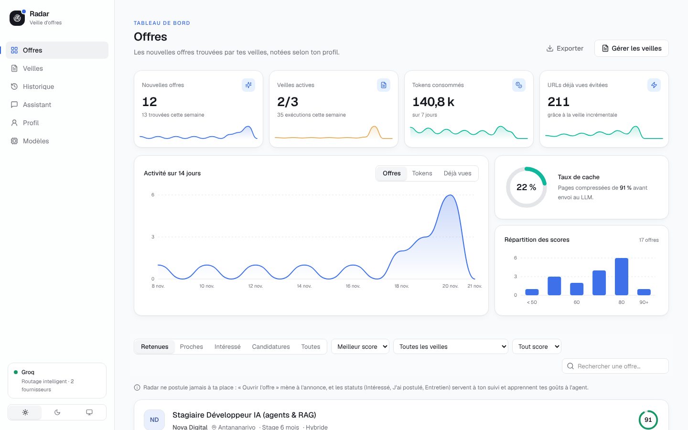
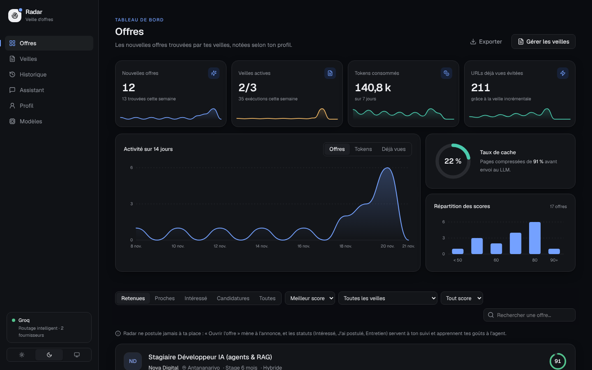
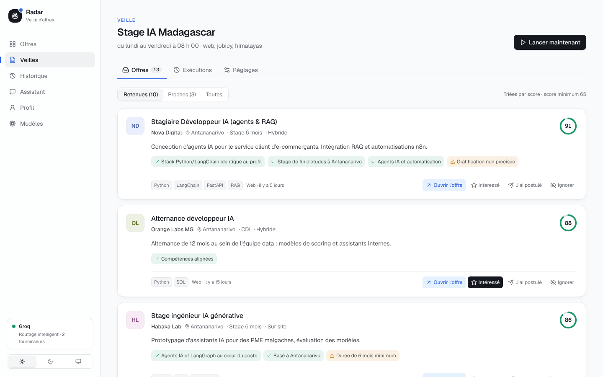
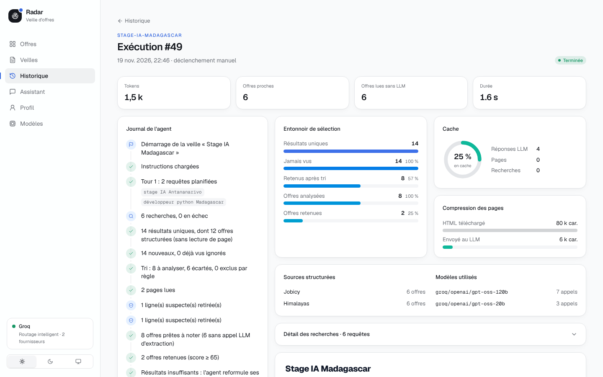
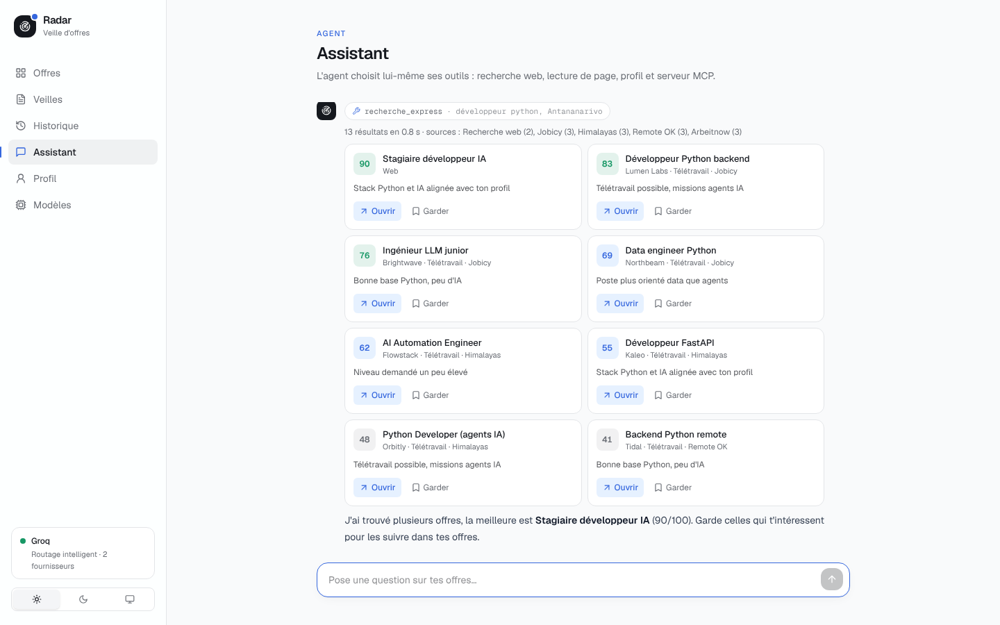
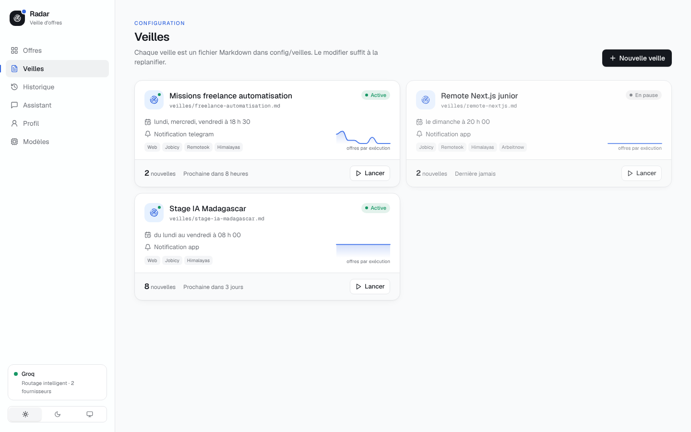
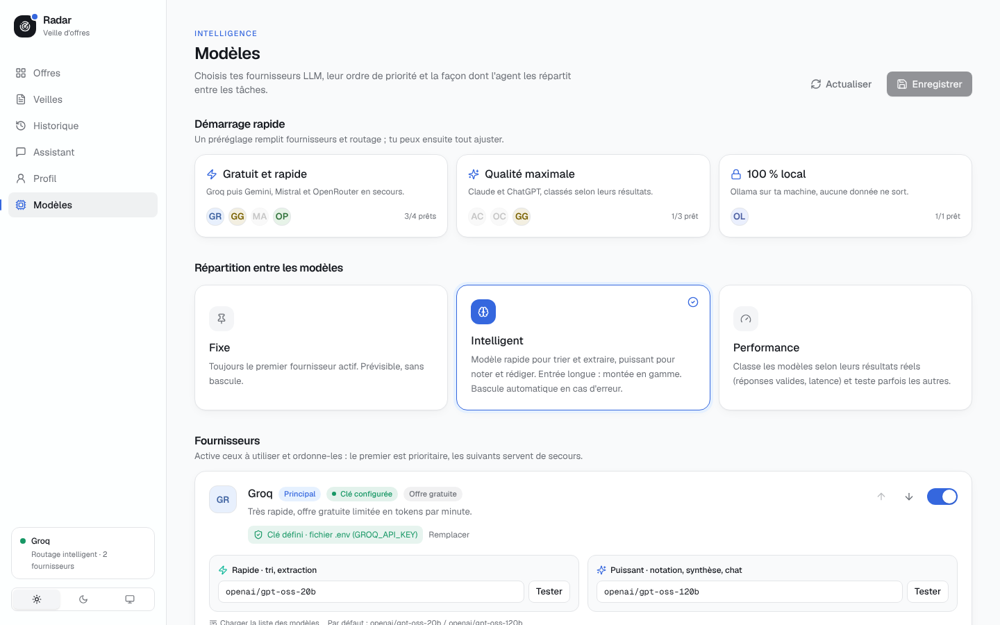

# Radar : agent de veille d'offres piloté par fichiers Markdown

Radar surveille automatiquement les offres d'emploi, de stage et de missions freelance.
Chaque veille est un fichier `.md` : l'en-tête YAML contient les paramètres (planning, score minimum,
exclusions), le corps contient les instructions en langage naturel. L'agent planifie ses recherches,
lit les pages, extrait et note les offres, puis ne livre **que les nouvelles offres pertinentes**.

Stack gratuite par défaut : Python, LangGraph, LangChain, MCP (FastMCP), LLM au choix (Groq, Gemini, Mistral,
OpenRouter, Ollama, ou OpenAI et Claude en payant), DuckDuckGo,
trafilatura, fastembed, FlashRank, SQLite, Next.js 16, Tailwind 4.

---

## Aperçu



| Mode sombre | Détail d'une veille |
|---|---|
|  |  |
| **Exécution suivie en direct** | **Recherche express dans l'assistant** |
|  |  |
| **Veilles Markdown** | **Choix des modèles et routage** |
|  |  |

Les captures ont été prises avec des données de démonstration.

---

## Démarrage rapide

```bash
cp .env.example .env          # puis colle au moins une clé : GROQ_API_KEY ou GEMINI_API_KEY (gratuites)
docker compose up -d --build
```

| Service | URL |
|---|---|
| Interface (et API via /api) | http://localhost:3000 |
| API (docs Swagger) | http://localhost:8000/docs |
| Serveur MCP | http://localhost:8001/mcp |

**Sans aucune clé, en local avec Ollama :**

```bash
# dans .env : LLM_PROVIDER=ollama (ou active Ollama dans la page Modèles)
docker compose --profile local-llm up -d --build
docker compose exec ollama ollama pull qwen2.5:3b
docker compose exec ollama ollama pull qwen2.5:7b
```

### Connexion lente ou instable

Les Dockerfiles gardent un cache des paquets pip et npm entre deux builds, et réessaient
automatiquement en cas de coupure. Si un build échoue sur une erreur réseau, relance simplement :
les paquets déjà téléchargés sont réutilisés. Pour éviter de saturer la connexion, construis
les images une par une :

```bash
docker compose build api
docker compose build web
docker compose up -d
```

Au premier lancement, les modèles d'embeddings et de reranking (environ 400 Mo) sont téléchargés
une seule fois dans le volume `radar-models`.

---

## Sources de recherche (rapides)

Chaque veille choisit ses sources (champ `connecteurs`, ou cases à cocher dans le formulaire) :

| Source | Type | Clé | Vitesse |
|---|---|---|---|
| `web` | DuckDuckGo + lecture des pages | aucune | lent, mais couvre tout (dont Madagascar) |
| `jobicy` | API publique, télétravail | aucune | rapide |
| `arbeitnow` | API publique, Europe et télétravail | aucune | rapide |
| `remoteok` | API publique, tech en télétravail | aucune | rapide |
| `himalayas` | API publique, télétravail | aucune | rapide |
| `apify` | n'importe quel Actor Apify | `APIFY_TOKEN` | moyen |

Les API renvoient des offres déjà structurées : ni lecture de page ni extraction par le LLM.
Pour les pages web, l'agent lit d'abord les données **JSON-LD `JobPosting`** que publient la plupart des
sites d'emploi (offre complète, sans LLM). Les pages rendues en JavaScript passent par **Jina Reader**
(gratuit, désactivable avec `READER_FALLBACK=aucun`). Les lectures se font en parallèle (`READ_CONCURRENCY`).

**Apify** : renseigne `APIFY_TOKEN`, coche Apify dans la veille, puis indique l'Actor (ex. `auteur/nom-actor`)
et, si besoin, son entrée JSON où `{requete}` est remplacé par chaque requête.

## Offres retenues, proches et suivi

- **Retenues** : score supérieur ou égal au score minimum de la veille.
- **Proches** : jusqu'à 20 points sous ce seuil. Elles sont enregistrées aussi, pour ne rien rater.
- Chaque offre indique sa **source** (web, fiche JSON-LD, Jobicy...) et la **requête** qui l'a trouvée ;
  la page d'une exécution détaille chaque recherche (résultats, durée, erreur).
- **Radar ne postule jamais à ta place.** « Ouvrir l'offre » mène à l'annonce ; « Intéressé »,
  « J'ai postulé », « Entretien » et « Ignorer » servent à ton suivi (onglet Candidatures) et apprennent
  tes goûts à l'agent.
- Chaque veille a ses onglets **Offres**, **Exécutions** et **Réglages**.

## Recherche express dans l'assistant

Sans créer de veille : « Cherche des offres de développeur Python à Antananarivo ». L'agent interroge
toutes les sources en parallèle, note les offres en un seul appel groupé et les affiche en cartes ; le
bouton « Garder » les ajoute à tes offres.

## Suivi en direct

Pendant une exécution, l'interface affiche la frise des étapes (Préparation, Recherche, Tri, Lecture,
Extraction, Notation, Enregistrement), l'avancement de l'étape en cours et chaque offre dès qu'elle est
notée. Les cartes de veille et le tableau de bord montrent aussi la progression. On peut quitter la page :
la veille continue en arrière-plan.

## Modèles et routage

La page **Modèles** de l'interface permet de choisir les fournisseurs actifs, leur ordre de priorité
(le premier est principal, les suivants servent de secours) et le modèle de chaque niveau :

- **Rapide** : planification des requêtes, tri, extraction ;
- **Puissant** : notation, synthèse, assistant.

| Fournisseur | Clé (.env) | Offre gratuite |
|---|---|---|
| Groq | `GROQ_API_KEY` | oui |
| Google Gemini | `GEMINI_API_KEY` | oui |
| Mistral AI | `MISTRAL_API_KEY` | oui (Experiment) |
| OpenRouter | `OPENROUTER_API_KEY` | modèles `:free` |
| OpenAI (ChatGPT) | `OPENAI_API_KEY` | non |
| Anthropic (Claude) | `ANTHROPIC_API_KEY` | non |
| Ollama | aucune (local) | oui |

Les clés se saisissent **dans l'app** (page Modèles) ou dans `.env`. Une clé saisie dans l'app est
chiffrée sur le serveur (Fernet, clé `RADAR_SECRET_KEY` ou fichier généré dans le volume de données),
prioritaire sur `.env`, et n'est **jamais renvoyée au navigateur** : l'interface n'affiche que sa
provenance et ses 4 derniers caractères. Radar est prévu pour un usage local : n'expose pas le port 3000
sur Internet sans authentification devant. Les identifiants de modèles
changent souvent : bouton **Charger la liste des modèles** pour voir ceux disponibles, puis **Tester**.

**Trois modes de routage** (`backend/app/llm.py`) :

| Mode | Comportement |
|---|---|
| Fixe | toujours le premier fournisseur actif, sans bascule |
| Intelligent | rapide ou puissant selon la tâche ; entrée longue = montée en gamme ; bascule automatique en cas d'erreur |
| Performance | classe les modèles selon leurs résultats réels (réponses valides, latence), avec un peu d'exploration |

**Fiabilité des appels LLM** :
- sortie JSON demandée dans le prompt (et mode JSON natif si disponible), validée par Pydantic,
  avec une tentative de réparation automatique ;
- erreurs classées : quota (attente puis nouvel essai), clé refusée, modèle retiré, délai, serveur ;
- disjoncteur : un modèle en échec est mis en pause quelques minutes et le suivant prend le relais ;
- chaque appel est mesuré (réussite, latence, tokens) et visible dans la page Modèles.

---

## Architecture

```
                         ┌──────────────────────────────┐
  config/*.md ──watchdog─▶  API FastAPI (:8000)          │
  (veilles, instructions,│  ├─ APScheduler (cron/veille) │
   profil)               │  ├─ Graphe LangGraph de veille│──▶ DuckDuckGo, pages web
                         │  ├─ Agent conversationnel     │──▶ Groq / Ollama
  Next.js (:3000) ─/api──▶  └─ RAG profil (Chroma+BM25)  │
                         └──────────────┬───────────────┘
                                        │ MCP (streamable HTTP)
                         ┌──────────────▼───────────────┐
  Claude Desktop ───────▶│  Serveur MCP maison (:8001)   │──▶ SQLite (offres, URLs vues, runs)
  MCP Inspector          │  tools · resources · prompts  │
                         └──────────────────────────────┘
```

Le navigateur ne parle qu'au port 3000 : un proxy interne (`frontend/app/api/[...path]/route.ts`)
relaie `/api/*` vers l'API, flux SSE compris. Aucune adresse n'est figée au build et il n'y a pas de CORS.

### Les 4 outils de l'agent

| Outil | Rôle | Fichier |
|---|---|---|
| `search_web` | Recherche DuckDuckGo avec cache exact et sémantique | `backend/app/tools/web.py` |
| `read_page` | Lecture trafilatura, robots.txt, compression par similarité | `backend/app/tools/web.py` |
| Serveur MCP `radar-veille` | Offres, URLs vues, mémoire, déclenchement | `backend/mcp_server/server.py` |
| `search_profile` | RAG hybride sur `config/profil/*.md` | `backend/app/tools/profile_rag.py` |

### Graphe d'une exécution (`backend/app/agent/watch_graph.py`)

```
load_context → plan_queries → search → filter_seen → triage → read_pages → extract → score
      ▲                                                                                │
      └──────── next_round ◄── (pas assez d'offres, budget OK, max 2 tours) ◄──────────┤
                                                                                       ▼
                                                             save (MCP) → digest → notify
```

- **plan_queries** (petit modèle) : requêtes variées, sans répéter celles déjà essayées.
- **filter_seen** (MCP) : veille incrémentale, une URL déjà traitée n'est jamais relue.
- **triage** (petit modèle) : tri sur titre + extrait, avant toute lecture de page.
- **extract** (petit modèle) : fiche structurée Pydantic.
- **score** (grand modèle) : note sur 100 avec extraits du profil trouvés par le RAG.
- **next_round** : l'agent reformule lui-même s'il manque des résultats.

---

## Fichiers Markdown

```
config/
├── instructions/
│   ├── AGENT.md       # règles générales de l'agent
│   └── scoring.md     # grille de notation
├── profil/
│   ├── cv.md          # indexé dans le RAG
│   └── preferences.md # toujours injecté au scoring
└── veilles/
    └── *.md           # une veille par fichier
```

Modifier, ajouter ou supprimer un fichier suffit : il est revalidé et replanifié en une seconde.
Un fichier invalide est désactivé, avec l'erreur affichée dans l'interface.

### Champs de l'en-tête

| Champ | Exemple | Règle |
|---|---|---|
| `nom` | `Stage IA Madagascar` | obligatoire |
| `planning` | `"0 8 * * 1-5"` | cron, au moins 6 h entre deux exécutions |
| `actif` | `true` | |
| `max_resultats` | `10` | 1 à 30 |
| `score_minimum` | `65` | 0 à 100 |
| `mots_cles` | `[stage python, dev IA]` | 15 max |
| `localisation` | `Antananarivo ou télétravail` | |
| `fraicheur_jours` | `7` | 1 à 60 |
| `sources` | `[sites carrières]` | indications pour l'agent |
| `exclure` | `[stage non rémunéré]` | exclusion stricte, sans LLM |
| `notification` | `app`, `telegram`, `aucune` | |
| `budget_tokens` | `40000` | optionnel |
| `langue` | `fr` | |

---

## Optimisations

| Technique | Où | Effet mesuré dans l'interface |
|---|---|---|
| Veille incrémentale (hash d'URL normalisée) | `repo.filter_unseen` | « Déjà vues ignorées » |
| Tri sur extraits avant lecture | nœud `triage` | moins de pages lues |
| Compression des pages (trafilatura + passages similaires) | `tools/web.py` | « Compression des pages » |
| Routage petit / grand modèle | `llm.py` | appels par taille |
| Cache exact des réponses LLM (SQLite) | `llm.py` | « Réponses en cache » |
| Cache sémantique des recherches | `tools/web.py` | événement « Cache sémantique » |
| Cache des pages (7 jours) | `tools/web.py` | « Réponses en cache » |
| Prompt à préfixe stable (règles, instructions, veille) | `agent/prompts.py` | cache de prompt fournisseur |
| Mémoire court terme taillée (`trim_messages`) | `agent/chat_graph.py` | historique borné |
| Mémoire long terme (retours utilisateur) | `repo.feedback_summary` | injectée dans le prompt |
| Budget de tokens par exécution | `context.py` | arrêt propre |

## Robustesse

- **Rien n'est perdu en cas d'échec** : une page non analysée (LLM indisponible, erreur réseau passagère,
  budget atteint) ou une offre au-delà de `max_resultats` n'est pas marquée comme vue. Elle est retentée
  à l'exécution suivante. Si aucun modèle ne répond, la veille s'arrête avec un message clair.
- **Arrêt d'une exécution** : bouton « Arrêter » sur la page d'une exécution en cours.
- **Entretien automatique** : chaque nuit (et au démarrage), les caches expirés et l'historique de plus de
  45 jours sont supprimés, pour que la base ne grossisse pas indéfiniment.
- **Export** : bouton « Exporter » sur la page Offres (CSV compatible Excel, filtres appliqués).

## Garde-fous

- **Hiérarchie des instructions** : règles système > `AGENT.md` > fichier de veille (`guardrails.py`).
- **Contenu web isolé** dans `<contenu_non_fiable>` et lignes d'injection retirées.
- **Domaines bloqués** : LinkedIn, Facebook, Instagram, X, TikTok.
- **robots.txt respecté** et délai de 2 s entre deux requêtes vers un même domaine.
- **Données personnelles filtrées** : seuls les e-mails génériques (contact@, rh@...) sont conservés,
  téléphones retirés, côté agent et côté serveur MCP.
- **Validation Pydantic** des fichiers `.md` avant enregistrement et des sorties LLM.
- **Limites** : fréquence minimale, requêtes, pages, tours et tokens par exécution.
- **Assistant en lecture seule** : liste blanche d'outils MCP, 12 étapes maximum.

---

## Brancher le serveur MCP sur Claude Desktop

Dans `claude_desktop_config.json` :

```json
{
  "mcpServers": {
    "radar": {
      "command": "npx",
      "args": ["-y", "mcp-remote", "http://localhost:8001/mcp"]
    }
  }
}
```

Tu peux aussi l'inspecter avec `npx @modelcontextprotocol/inspector`.

| Type | Nom |
|---|---|
| tools | `list_watches`, `filter_unseen`, `mark_seen`, `save_offers`, `get_new_offers`, `search_offers`, `update_offer_status`, `get_feedback_summary`, `run_watch` |
| resources | `watch://{slug}`, `offers://new` |
| prompts | `veille(slug)` |

---

## Scénario de démonstration (5 min)

1. **Veilles** → « Nouvelle veille » : écrire un fichier, montrer la validation en direct
   (essayer `planning: "*/10 * * * *"` pour déclencher le garde-fou de fréquence).
2. « Enregistrer et lancer » : suivre la timeline en direct (requêtes, tri, garde-fous).
3. **Offres** : marquer une offre « Intéressé » et une « Ignorer » (mémoire long terme).
4. Relancer la même veille : montrer « déjà vues ignorées », le cache et la baisse des tokens.
5. Modifier le fichier `.md` dans un éditeur de texte : la veille est replanifiée automatiquement.
6. **Assistant** : « Quelles sont mes meilleures offres ? » (appels d'outils visibles).
7. **Modèles** : passer en mode Performance, tester un modèle, montrer la bascule et les statistiques.
8. Claude Desktop : appeler `get_new_offers` sur le même serveur MCP.

## Développement sans Docker

```bash
# backend
cd backend && python -m venv .venv && source .venv/bin/activate
pip install -r requirements.txt
export CONFIG_DIR=../config DATA_DIR=../data MODELS_DIR=../models \
       MCP_URL=http://localhost:8001/mcp API_URL=http://localhost:8000 MCP_HOST=127.0.0.1
python -m mcp_server.server &          # terminal 1
uvicorn app.main:app --reload          # terminal 2

# frontend
cd frontend && npm install && npm run dev
```
